# MoE load-balancing lab

An instrumented testbed that runs on a CPU, built for one question: **why do Mixture-of-Experts routers send most tokens to a
few experts, and what turns an MoE into an actual mixture rather than a dense model in disguise?**

The repo has five parts:
- A from-scratch MoE layer in which every routing and balancing strategy is a swappable option.
- Datasets with *known* ground-truth structure, so "specialisation" can be measured rather than eyeballed.
- A set of diagnostics, including a check of which of them actually detect what they claim to.
- Seven experiment suites, including a held-out test that was pre-registered before it ran.
- The results of running them on 4 CPU cores: ~5,000 synthetic runs and 55 small language-model runs.

The work ran in two rounds:
- **Round 1** (E1–E3) found the mechanism and proposed a fix.
- **Round 2** (E1 v2, E3 v2, E4–E7) attacked round 1's own stated limitations:
  - more seeds, with paired statistics;
  - per-method tuning;
  - a pre-registered held-out test;
  - deep models and non-linearly-separable tasks;
  - a larger language model;
  - a script for real pretraining checkpoints.

Where round 2 contradicted round 1, this README says so.

## TL;DR

1. **It isn't overfitting.** Busy experts fit their own tokens *worse*: they are capacity-starved.
   - With scarce data, busy experts also generalise *better*, and the few experts that overfit are the lightly
     used ones.
   - With plentiful data, the generalisation gap is unrelated to load (20 seeds).
   - Idle experts aren't underfit so much as *never trained*.
2. **Collapse is mostly a race decided early.**
   - In the synthetic tasks, median death step is 10 and 99–100% of deaths happen before step 100.
   - In the 4-layer LM, 78% of eventually-dead experts are dead by step 100 (3% of training).
   - Some LM experts come back later, so it is less final than in the synthetic tasks.
3. **The core cause is a greedy router that only gets feedback about the expert it picked.**
   - Each latent task ends up with one owning expert.
   - Which expert wins each task is effectively random.
   - Losers stop receiving gradient.

   The resulting random-owner model, E·(1−1/E)^C dead experts, was **pre-registered and predicted dead-expert counts
   in three never-seen regimes** (17.7 observed vs 19.3 predicted, 0.0 vs 0.3, 5.1 vs 5.7).
4. **In deep models, upstream layers learn to steer tokens onto favoured experts.**
   - With the router frozen, collapse still happens, slowly (median death step 750 in the LM).
   - It disappears when the routing gradient is also blocked from reaching the representations: 0.1 dead experts
     per layer, vs 4.9 with the router frozen alone.
   - When the router can learn, though, its weights carry ~97% of the change in its logits.
5. **Why SGD makes collapse much worse (77% dead vs 39% with Adam): mostly the router's unnormalised updates.**
   Equalising each expert's router-gradient norm, plus normalising expert updates by load, brings SGD back to the
   Adam baseline.
6. **Balancing helps, if it is strong enough early. "Release after warm-up" is the most robust family, but the
   specific recipe I proposed did not win the pre-registered test.**
   - After per-method tuning, aux-then-release had the best worst case on held-out regimes (≤ 1.15× the best
     method) and beat no balancing in 6 of 7.
   - Sinkhorn-then-release narrowly had the better average (1.051 vs 1.064). Pre-registered P1: **fail**.
7. **"Forcing balance hurts when experts outnumber skills or skills are skewed" only holds for strong balancing.**
   With tuned (weaker) settings it did not generalise to held-out regimes (pre-registered P4: **fail**). Only strong
   bias balancing and expert-choice routing hurt there.
8. **When the router cannot see the task structure, no balancing method helps.** On tasks that aren't linearly
   separable:
   - learned routing recovers 14% of the task identity without upstream feature layers, and ~55% with them;
   - every MoE closes under half of the gap to oracle routing;
   - a dense model with the same total parameters does as well (0.249 vs 0.270 for the best MoE).

   That is "dense in disguise" from failed specialisation, not imbalance.
9. **In the 4-layer LM, any balancing helps, and the method matters little.**
   - Aux α ∈ {0.003, 0.01, 0.03}, bias balancing and a fixed byte hash all land at 1.487–1.498 nats/byte, vs 1.526
     unbalanced.
   - Release did not help there (1.497).
   - All MoEs close at most ~half the gap between dense-active (1.558) and dense-total (1.414).
   - The 6-layer, 32-expert GPU preset (Kaggle T4, 19 of 21 runs) does **not** confirm this. It is data-limited: about
     55 passes over a 1.5 MB corpus, so every model's val loss bottoms out around step 2000–4000 and then rises.
     At each run's best checkpoint, every method lands at 1.340–1.354, dense models included, and every paired 95%
     CI against no balancing includes 0. Its routing results do replicate (early collapse, the router's weights
     carry ~94% of the logit change).

---

## 1. Check the premise first

Three parts of the usual story don't hold up, and they change what you should build.

**"Most tokens go to one or two experts" mixes up two different things.**
*Top-k* routing sends **each token** to k experts (k = 1 or 2 in Switch, Mixtral, etc.). That sparsity is the
whole point of an MoE and is not a failure. The failure is **global load imbalance**: across many tokens, a few
experts get most of the traffic and others get almost none. The diagnostic is the *distribution of load across
experts*, not how many experts each token uses. This repo reports it in two ways:
- *Effective experts*: the exponential of the entropy of the load. 8 of 8 means perfectly even; 1 means everything
  is on one expert.
- *Dead experts*: experts that get less than 10% of a fair share of tokens.

Well-tuned production MoEs (with an aux loss or bias balancing) generally don't collapse in this crude sense. Their
open problem is whether the experts that *are* used actually specialise.

**"Overfitted" is the wrong word.**
Overfitting means low training loss and a large gap between training and validation loss. A heavily used expert
sees *more* data per parameter, so if anything it should overfit *less*. [E1](#is-a-popular-expert-overfit)
measures this directly and finds the reverse of the overfitting story. The accurate description is "over-allocated
and starved", not "overfit and underfit".

**Balanced load ≠ a real mixture.**
You can force perfectly even load and still have interchangeable experts. Hash routing does this by construction,
and so does forcing balance onto data with fewer distinct "skills" than experts. So this repo measures four separate
things:
- *Load*: how evenly tokens are spread.
- *Specialisation*: mutual information between routing and the ground-truth structure.
- *Utility*: how much the loss rises when each expert is removed.
- *Dense-equivalent size*: how wide a plain MLP must be to match the MoE.

## 2. The mechanism: a greedy bandit that only ever tastes what it picks

For a top-1 router with gate `p = softmax(Wx)`, chosen expert `e`, and output `y = p_e · E_e(x)`, the router
gradient is

```
∂L/∂logit_j = p_e · (δ_ej − p_j) · ⟨∂L/∂y, E_e(x)⟩
```

Only the **chosen** expert `E_e` appears in it. Every other expert `j` is moved by "how useful `e` was, times
`−p_j`", whatever `j` itself would have done. Unchosen experts also get **zero** parameter gradient. From there:

1. **The router is a contextual bandit with no exploration.** It acts greedily (argmax) and only observes the arm
   it pulled, so it never learns that an idle expert might be better somewhere.
2. **Sharing a task is unstable, so each task gets one winner.** Suppose two experts split a latent task. The
   slightly better one gets a slightly larger push, takes more of the task, trains more on it, and gets better
   still. Measured: after training, every latent task is served by **1.00–1.02 experts**.
3. **Nothing coordinates which expert wins each task.** Some experts win two or three tasks and others win none.
   - If owners were assigned at random, about `E·(1−1/E)^C` experts would end up dead.
   - Observed vs that prediction: **12.4 vs 11.6** (32 experts, 32 tasks); **8.4 vs 9.6** (16 experts, 8 tasks);
     **1.3 vs 2.8** (8 experts, 8 tasks; small systems do somewhat better than random).
   - With 32 experts, freezing the experts at their random init *still* kills 11.4. The greedy, uncoordinated
     choice is the core of the problem; expert learning amplifies it and makes it permanent.
4. **Losing is absorbing.** A loser gets no tokens, so no gradient, so it stays at its random initialisation. That
   makes it worse than every trained expert on every task, so the greedy router never picks it again. It is a
   self-fulfilling prophecy, exactly like dead centroids in k-means or codebook collapse in VQ-VAEs
   (see the counterfactual heat-map below).
5. **Router confidence then locks the result in.** Logit scale grows and router entropy falls towards zero over
   the next ~1000 steps, which makes any later switch even less likely.

**Why the textbook aux loss is often too weak.** The Switch loss is `L_aux = α·E·Σ f_i·P_i`, where `f_i` is the
fraction of tokens dispatched to expert `i` (not differentiable) and `P_i` is its mean router probability. Its
gradient on a logit is

```
∂L_aux/∂logit_i ∝ P_i · (f_i − Σ_j f_j P_j)
```

For a dead expert (`f_i = 0`), the restoring push is proportional to its own router probability `P_i`.
- Once the router is confident (`P_i ≈ 0`), the aux loss can no longer revive that expert
  (`tests/test_moe.py::test_aux_loss_pull_on_a_dead_expert_vanishes_with_its_probability`).
- The loss has to win the race in the first ~100 steps, so `α` must be large relative to the task-loss gradient at
  that point. `α` is not scale-free: a value tuned for one loss scale is weak or strong for another.

## 3. Results

> **Round-2 corrections to this section** (20 paired seeds, Holm-adjusted; see [round 2](#3b-round-2-attacking-the-limitations)):
> - With 32 experts, identical expert initialisation *increases* collapse (+2.1 dead experts, p = 0.004) rather than
>   having no effect.
> - Zero-initialised expert outputs reliably *reduce* it (−1.7, p = 0.005).
> - The router-LR and frozen-experts effects in E32 are not distinguishable from zero.
> - With plentiful data the overfitting-gap correlation is ≈ 0 (−0.07), not −0.35.
> - The tuned global aux α is 0.03, not 0.1.
> - The claim that forced balance hurts when experts > skills did not survive the held-out test with tuned settings.

All synthetic numbers are means over 8 seeds (± standard error). Each seed changes both the task and the
initialisation. The regimes are:

| regime | experts | latent tasks | task frequencies | what it represents |
|---|---|---|---|---|
| E8 | 8 | 8 | uniform | the textbook case: one skill per expert |
| E32 | 32 | 32 | uniform | same, at a size where collapse is severe |
| E16C8 | 16 | 8 | uniform | more experts than distinct skills |
| E8zipf | 8 | 8 | Zipf (s = 1.2) | skewed skill frequencies, like token frequencies in text |

Each expert is a 16→8→8 MLP. Each task's teacher is a random 16→32→8 network. A dense MLP with the active
parameters of one expert (width 8) reaches val loss 0.66 on E8, versus 0.09 for oracle routing, so specialisation
matters a lot in this task.

### E1 – why does it happen?

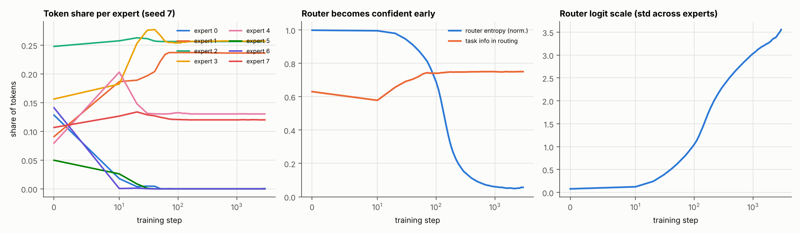

Left: a typical run without balancing. Experts 0, 5 and 6 lose all their tokens within ~50 steps, long before the
router becomes confident (middle) or its logits grow (right). Note the log-scaled time axis.

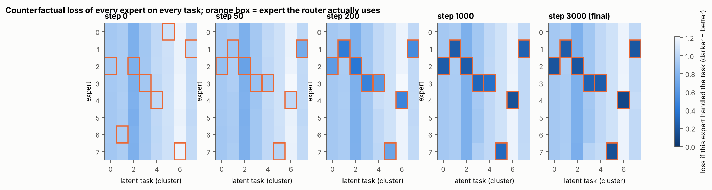

This shows what *each* expert would score on *each* task if it handled that task alone; the orange box marks the
expert the router actually uses.
- At step 0 every expert is equally mediocre everywhere.
- By step 200 each task has one owner that has improved on it.
- The dead experts (rows 0, 5 and 6) stay at their initial loss on *every* task for the rest of training. They were
  never worse by nature; they are worse because they were never trained.

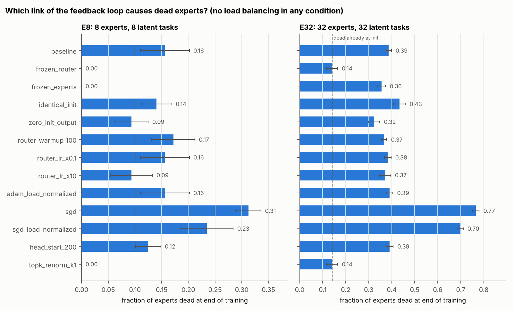

| intervention (no balancing anywhere) | dead / 8 (E8) | dead / 32 (E32) | reading |
|---|---|---|---|
| baseline | 1.25 ± 0.37 | 12.4 ± 0.4 | |
| freeze router (random fixed routing) | 0 | 4.5 ± 0.8 (= dead at init) | no *new* deaths without a learning router |
| freeze experts (router learns to pick among random experts) | 0 | 11.4 ± 0.6 | at scale, greedy selection alone is enough |
| identical expert init | 1.12 ± 0.23 | 13.9 ± 0.8 | initial expert asymmetry is not needed |
| expert output layer initialised to 0 | 0.75 ± 0.25 | 10.4 ± 0.8 | small help: less noise for the router to react to |
| router frozen for first 100 steps | 1.38 ± 0.32 | 11.8 ± 0.4 | no help: deaths just move to right after step 100 (median death step 110 in E32, vs 10) |
| router LR ×0.1 / ×10 | 1.25 / 0.75 | 12.3 / 11.9 | no consistent effect |
| Adam + per-expert grads rescaled by 1/load | 1.25 ± 0.37 | 12.5 ± 0.5 | identical, as Adam's scale invariance predicts |
| **SGD** | **2.50 ± 0.19** | **24.5 ± 0.5** | update size ∝ token count: strong amplifier |
| SGD + per-expert grads rescaled by 1/load | 1.88 ± 0.40 | 22.4 ± 0.4 | only part of SGD's amplification comes from expert updates |
| expert 0 trained alone for 200 steps first | 1.00 ± 0.19 | 12.5 ± 0.5 | no takeover (expert 0 ends with 17% of tokens vs a fair 12.5%) |
| Mixtral-style renormalised gate with k = 1 | 0 | 4.5 ± 0.8 | the gate is ≡ 1, so the router gets **no** gradient: an implementation pitfall |

Timing and ownership (no balancing):

| regime | dead | random-owner prediction | experts per task | median death step | deaths before step 100 |
|---|---|---|---|---|---|
| E8 | 1.25 ± 0.37 | 2.75 | 1.00 | 10 | 100% |
| E16C8 | 8.38 ± 0.18 | 9.55 | 1.00 | 10 | 100% |
| E32 | 12.38 ± 0.37 | 11.59 | 1.02 | 10 | 99% |

#### Is a popular expert overfit?

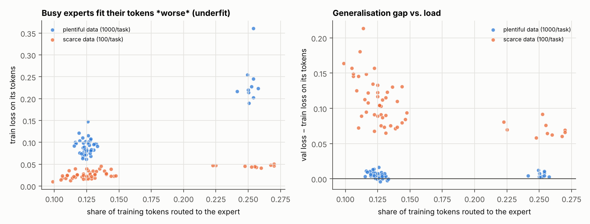

Each point is one expert in one run. The orange points come from a data-scarce variant: 100 examples per task and
4× wider experts, so overfitting is actually possible there.

| setting | ρ(load, own train loss) | ρ(load, val − train gap) | gap: experts owning 1 task | gap: experts owning ≥2 tasks |
|---|---|---|---|---|
| plentiful data (1000/task) | +0.43 ± 0.12 | −0.35 ± 0.07 | 0.005 | 0.006 |
| scarce data (100/task) | +0.69 ± 0.10 | −0.64 ± 0.13 | 0.112 | 0.070 |

Busier experts have *higher* training loss and a *smaller* generalisation gap. "Overfitting" has the sign wrong.

### E2 – what fixes it, and is balance even the right target?

The table below summarises 18 methods across the four regimes. Each cell is val loss divided by the best
non-oracle method in that regime (1.00 = best there). Rows are sorted by geometric mean. Full per-regime tables,
covering dead experts, effective experts, task information, ablation utility and dense-equivalent size, are in
[`results/summary_e2.md`](results/summary_e2.md).

| method | E8 | E32 | E16C8 | E8zipf | geo-mean | worst |
|---|---|---|---|---|---|---|
| **aux α=0.1 for 300 steps, then off** | 1.14 | 1.26 | **1.00** | 1.04 | **1.10** | **1.26** |
| aux-free bias for 300 steps, then frozen | **1.00** | 1.07 | 1.31 | 1.33 | 1.17 | 1.33 |
| aux α=0.1 (Switch loss) | 1.02 | 1.09 | 1.38 | 1.33 | 1.19 | 1.38 |
| revive dead experts by splitting the busiest | 1.24 | 1.42 | 1.23 | 1.06 | 1.23 | 1.42 |
| Sinkhorn selection (S-BASE) | 1.02 | 1.39 | 1.39 | 1.31 | 1.27 | 1.39 |
| Sinkhorn for 300 steps, then plain top-k | 1.28 | 2.27 | 1.03 | 1.03 | 1.32 | 2.27 |
| aux-free bias (DeepSeek-V3) | 1.28 | **1.00** | 1.43 | 1.73 | 1.33 | 1.73 |
| aux α=0.01 (the common default) | 1.48 | 2.03 | 1.09 | 1.04 | 1.36 | 2.03 |
| no balancing | 1.54 | 2.33 | 1.23 | **1.00** | 1.45 | 2.33 |
| expert-choice routing | 1.25 | 1.86 | 3.06 | 1.95 | 1.93 | 3.06 |

Methods run only on E8 and E32 (val loss, E8 / E32): z-loss 1e-3 0.145 / **0.346** (worse than no balancing,
0.141 / 0.270); aux 1e-2 + z-loss 0.139 / 0.302; exploration noise 0.154 / 0.221; cosine router 0.143 / 0.209;
hash routing 0.321 / 0.462; oracle 0.092 / 0.106.

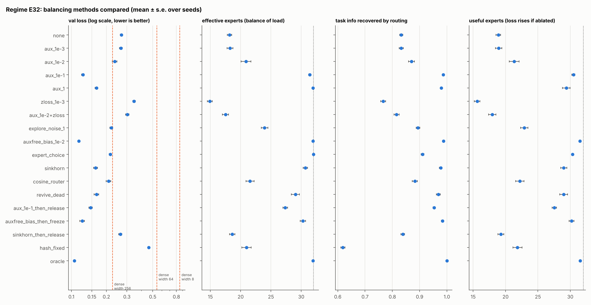

**When the data has one equally common skill per expert (E8, E32), balancing is the cure.**
- Strong aux loss, bias balancing and Sinkhorn all remove the dead experts and land close to oracle routing. In E32
  the best of them (bias, 0.116) beats a dense MLP with *all 32 experts' parameters active* (0.226 at width 256),
  using one expert's compute per token.
- Even the unbalanced MoE (0.270) is far from "dense in disguise" in compute terms: it matches a dense MLP about 26
  experts wide. What it gives up is the factor of 2.3 in loss that the fixes recover.
- Exploration noise and the cosine router help partially. z-loss is a stabiliser for logit magnitude, not a
  balancer: here it made collapse worse.

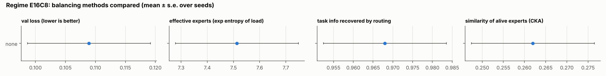

**When there are more experts than skills (E16C8), balance just splits each skill across two experts.**
- With no balancing, exactly one expert per task survives (8 dead) at loss 0.109.
- Forcing balance keeps all 16 alive but at 1.97 experts per task, and it is *worse*:
  - Switch aux α=0.1: 0.122
  - Sinkhorn: 0.123
  - aux-free bias: 0.126
  - expert choice: 0.271
- The ablation column shows the redundancy. Removing one twin of a pair costs little, so only ~6–10 of the 16
  balanced experts are "useful".
- Balancing early and then releasing gives the best result of any method (0.089). Early on, every expert gets
  trained; then the best-trained candidate for each skill wins and the spares die off.

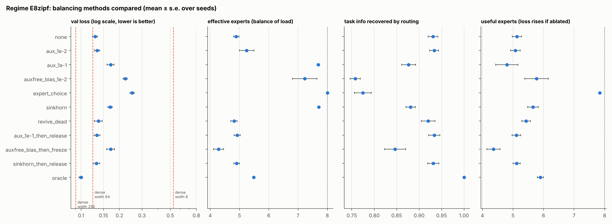

**When skill frequencies are skewed (E8zipf), the optimal routing is imbalanced, and forcing balance hurts.**
- Oracle routing uses only 5.5 effective experts out of 8.
- Every method that keeps forcing balance is worse than doing nothing (0.129): Switch aux α=0.1 0.171, Sinkhorn
  0.169, aux-free bias 0.222, expert choice 0.251.
- The damage concentrates on the rarest tasks (loss 0.29 → 0.33–0.45). Their dedicated experts get diluted with
  overflow from the common task.
- The release variants (0.132–0.133) avoid that penalty.
- Nothing closes the gap to the oracle (0.100). The remaining loss is mostly on the rare tasks, which lose the race
  to share an expert.

**Release is not free.**
- Sinkhorn-then-release falls straight back to 12 dead experts in E32. Sinkhorn balanced the *selection* while the
  router's own logits stayed collapsed, and removing the mask exposes that.
- After an aux loss is released, the router keeps most of what it learned (3.6 dead, vs 12.4 with no balancing and
  0.4 with continuous aux).
- After a frozen bias, the router keeps nearly all of it (1.25 dead), but a frozen bias also keeps forcing balance
  on Zipf data.

### E3 – does it hold in a real (tiny) language model?

**Setup.**
- Byte-level decoder: 2 layers, width 128, 4 heads, context 128.
- Each FFN is 8 experts of width 128 with top-2 routing: ≈350k active / 746k total parameters.
- Training: 2500 steps at batch 32, on an even mix of Shakespeare, Python standard-library source and CPython
  reference docs.
- 2 seeds per method, so treat differences below ~0.03 nats/byte as noise.

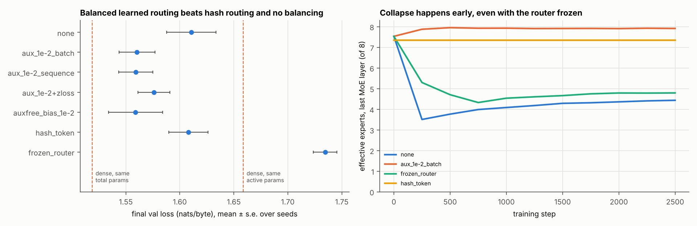

| method | val loss (nats/byte) | effective experts (of 8) | dead / layer | useful experts (ablation) | domain info | byte-explained |
|---|---|---|---|---|---|---|
| dense, same active params (width 256) | 1.659 ± 0.004 | – | – | – | – | – |
| dense, same total params (width 1024) | 1.519 ± 0.015 | – | – | – | – | – |
| no balancing | 1.611 ± 0.023 | 4.41 | 2.0 | 4.3 | 0.04 | 0.77 |
| aux α=0.01, batch-level | 1.560 ± 0.016 | 7.88 | 0 | 7.2 | 0.07 | 0.77 |
| aux α=0.01, sequence-level | 1.559 ± 0.016 | 7.87 | 0 | 7.2 | 0.03 | 0.80 |
| aux α=0.01 + z-loss | 1.576 ± 0.015 | 7.93 | 0 | 7.3 | 0.05 | 0.80 |
| aux-free bias | 1.559 ± 0.025 | 7.98 | 0 | 7.3 | 0.09 | 0.71 |
| fixed hash of the byte | 1.608 ± 0.018 | 7.34 | 0 | 7.7 | 0.01 | 1.00 |
| router frozen at init | 1.735 ± 0.011 | 5.55 | 1.5 | 4.3 | 0.07 | 0.27 |

Columns 3–7 are averaged over the two MoE layers.
- *domain info* = MI(top-1 expert; domain) / H(domain).
- *byte-explained* = MI(top-1 expert; current byte) / H(expert).

Full table: [`results/summary_e3.md`](results/summary_e3.md).

1. **The same failure appears, with the same early timing.**
   - Without balancing, effective experts drop from 7.5–7.8 at init to 3.5–4.2 by step 250 (the first checkpoint),
     with 2.5–4 dead experts per layer.
   - It then partly recovers, to ~4.4 effective with 2 dead. Unlike the synthetic task, the router's inputs keep
     changing as the network learns, so a starved expert is occasionally picked up again.
2. **Freezing the router does not prevent collapse in a deep model.**
   - With router weights fixed at their random init, layer 1 still falls to 4.8 effective experts with 2.5 dead.
   - Its router-logit spread grows 4× (0.22 → 0.96) although the router never changes. The layers below learned to
     move token representations towards the experts that were helping.
   - This is the representation-collapse pathway (Chi et al., 2022) that a single-layer synthetic task cannot show.
   - It is also the worst model here, worse than the dense model with the same active parameters.
3. **Here the textbook aux loss (α=0.01) is enough.**
   - Load is balanced (7.9 effective, 0 dead) and val loss is 1.560 vs 1.611. Measured on the gap between the dense
     model with the MoE's active parameters and the one with its total parameters, that takes the MoE from 34% to
     71% of the way.
   - The same α was far too weak in the synthetic task. α competes with the task-loss gradient, whose scale differs
     between setups, so it has to be tuned per setup rather than copied.
4. **Batch-level aux, sequence-level aux and aux-free bias tie on loss** (1.559–1.560). z-loss on top is slightly
   worse (1.576), the third setting where it doesn't help balance.
5. **Unbalanced learned routing is no better than a fixed hash of the byte** (1.611 vs 1.608). Learned routing
   only paid off once it was balanced.
6. **Experts specialise by byte, not by domain.**
   - In any layer, routing reveals at most 13% of the information about which domain a sequence came from.
   - For every learned router, the current byte explains 53–91% of routing entropy (≈0.9 in layer 0, 0.5–0.7 in
     layer 1).
   - At this scale no "code expert" emerges: experts carve up the byte vocabulary and local context. This matches
     what the Mixtral report saw at scale.
   - Batch-level balancing leaves about twice the domain information in layer 1 that sequence-level balancing does
     (0.11 vs 0.05), which is the direction Qiu et al. (2025) report. With 2 seeds and no loss difference, treat it as
     suggestive only.

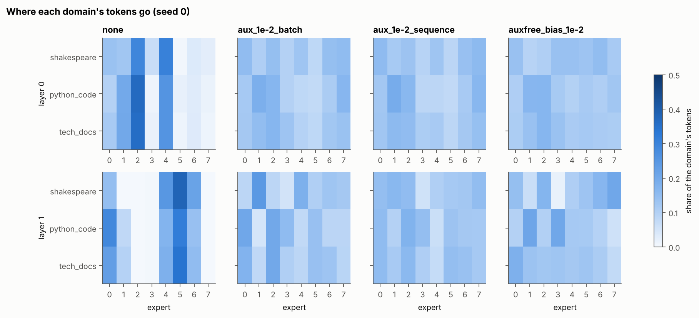

## 3b. Round 2: attacking the limitations

Round 1 ended with a list of limitations. Round 2 turned each one into an experiment:

| limitation (round 1) | what round 2 did | status |
|---|---|---|
| 8 seeds; small effects ambiguous | E1 v2: 20 paired seeds, bootstrap CIs, Holm-adjusted permutation tests | **resolved** (two round-1 calls corrected) |
| SGD amplification untested | 2×2 factorial (which part uses SGD) + router row-norm / expert load-norm probes | **resolved** |
| hyperparameters untuned | E4: grid per method, tuned on separate seeds and the validation split, reported on the test split | **resolved** for the synthetic suite |
| release recipe tested on the regimes that suggested it | E5: frozen configs, 7 never-seen regimes, predictions committed before running | **resolved**; mixed result |
| single layer, fixed inputs, linear tasks, MSE | E5/E6: deep MoE stacks, XOR tasks (not linearly separable), cross-entropy, top-2 | **resolved** at toy scale |
| representation pathway unmeasured | logit decomposition (router weights vs representations), detach-input and freeze interventions | **resolved** at toy and small-LM scale |
| toy LM, 2 seeds, no release | E3 v2: 4 layers, 16 experts, 3 seeds, release, decomposition, dense early logging; GPU preset run on a Kaggle T4 (19/21 runs) | **partly resolved**: routing replicates; the GPU preset is data-limited and can't rank methods (see below) |
| dense-equivalent saturates | "gap closed" between dense-active and oracle as the primary metric; power-law fit, with extrapolation marked | **resolved** |
| CKA uninformative | metric validation on positive/negative redundancy controls | **resolved** |
| "collapse might be late at scale" | death timing in the LM (CPU and GPU presets); E7 script for real OLMoE checkpoints | **open** at real scale (E7 not run yet, see below) |

### E1 v2 – the mechanism with 20 paired seeds

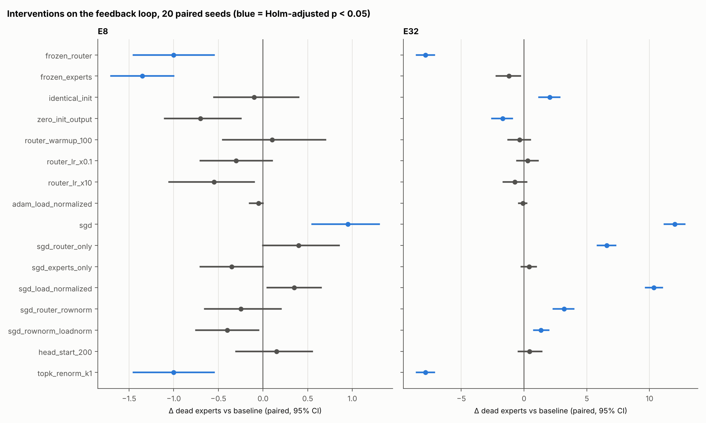

Comparisons are paired: each seed fixes the task and the initialisation across conditions. A direction is claimed
only when the Holm-adjusted p < 0.05. Full table: [`results/summary_e1v2.md`](results/summary_e1v2.md).

**Held up:**
- Freezing the router prevents new deaths. With 32 experts it leaves 4.5 dead, all of them already dead at init.
- Adam with expert gradients rescaled by load is identical to plain Adam.
- Router warm-up, router LR and a head start have no clear effect.
- One owner per task (1.00–1.03 experts per task).
- Median death step 10.

**Corrected:**
- With 32 experts, identical expert initialisation *adds* 2.1 dead experts [1.2, 2.9].
- Zero-initialised expert outputs *remove* 1.7 [1.0, 2.6].
- In E8 neither is distinguishable from zero.

**Where SGD's extra collapse comes from** (dead experts with 32 experts and 32 tasks; Adam everywhere = 12.3):

| router | experts | dead | reading |
|---|---|---|---|
| SGD | Adam | 18.9 | SGD on the router alone adds +6.6 |
| Adam | SGD | 12.7 | SGD on the experts alone adds nothing clear |
| SGD | SGD | 24.3 | together +12.0: a strong interaction |
| SGD, router rows equal-norm | SGD | 15.5 | equalising the router's per-expert gradient removes ~70% of the excess |
| SGD, router rows equal-norm | SGD, load-normalised | 13.7 | ≈ the Adam baseline |

Main effects (paired, averaged over the other factor): router SGD +9.1 [8.5, 9.7]; expert SGD +2.9 [2.5, 3.4];
interaction +5.0 [4.0, 6.0].

The mechanism: under SGD, a popular expert's router row receives a larger gradient, which accelerates the greedy
race. Adam's per-parameter normalisation removes exactly that.

### E4 – tuning every method

Each method's hyperparameter grid was run on the four round-1 regimes, with tuning seeds 100–103 scored on the
validation split. One *global* config per method was then chosen and evaluated on fresh seeds 0–9 on the test
split. Full tables: [`results/summary_e4.md`](results/summary_e4.md).

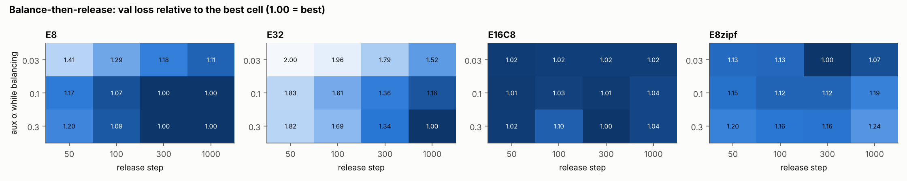

- **Tuning barely changed the ranking.** Spearman ρ = 0.92 against round 1's untuned ranking.
  - Aux-then-release is still most robust: geo-mean 1.08, worst 1.22.
  - Next come bias-then-freeze (1.13), revive-dead (1.19) and sinkhorn-then-release (1.19).
  - Continuous aux is 1.22 and no balancing is 1.46.
- **The best α depends on the regime** ([sensitivity plot](results/figures/e4_sensitivity.png)). With 32
  experts, the optimum is α ≈ 0.3. With more experts than skills, it is ≤ 0.01, where stronger balance splits skills.
  That conflict is why a single strong setting can't be best everywhere, and why releasing after warm-up helps.
- **The best global settings:**
  - aux α = 0.03 (round 1 used 0.1);
  - release after 1000 steps at α = 0.3;
  - bias rate 0.1.

  The best release step depends on the regime: 1000 for E32, 300 for E16C8 and Zipf. With 32 experts, releasing
  too early is the costly mistake (up to 2× worse at step 50).
- **"Gap closed" replaces the saturating dense-equivalent.** It is 0 for a dense model with the active parameters
  and 1 for oracle routing.
  - Aux-then-release and bias-then-freeze reach 0.98–1.00 on E8/E32/E16C8 (sinkhorn-then-release only 0.86 on E32).
  - Nothing exceeds 0.95 on Zipf.

**Which redundancy metrics work.** Each metric was tested on a positive control (forced balance: each task split
across ~2 experts) against a negative control (free routing: one expert per task), on the same seeds:

| metric | separates the controls? | standardised effect |
|---|---|---|
| CKA over a shared probe set (round 1's metric) | **no** | −0.24 |
| CKA restricted to alive experts | barely | +0.55 |
| CKA on each pair's *routed* tokens | yes | +5.7 |
| substitution gap (how much worse the next-best expert is on an expert's own tokens) | yes | −8.8 |
| useful experts ÷ alive experts (ablation) | yes | −1.5 |
| experts per task (needs ground truth) | yes | +35.6 |

Round 1's CKA was uninformative because it compared experts on inputs they never see.

### E5 – the pre-registered held-out test

[`experiments/PREREGISTRATION.md`](experiments/PREREGISTRATION.md) was committed (`dd7897a`) before any E5 run. It
froze the global configs, seven new regimes and five predictions. Verdicts below are computed mechanically by
`analyze2.py`. Full tables: [`results/summary_e5.md`](results/summary_e5.md).

| id | prediction | result | verdict |
|---|---|---|---|
| P1 | aux-then-release has the lowest geo-mean ratio | sinkhorn-then-release 1.051, aux-then-release 1.064 | **FAIL** |
| P2 | aux-then-release worst case ≤ 1.30 | 1.15 (the best worst-case of all 13 methods) | **PASS** |
| P3 | aux-then-release beats no balancing in ≥ 6 of 7 regimes | 6 of 7 | **PASS** |
| P4 | ≥ 3 of 4 continuous-balance methods worse than none (E32C16) | only bias and expert choice are worse | **FAIL** |
| P4 | same, Zipf s = 0.8 | only bias and expert choice are worse | **FAIL** |
| P5 | random-owner model predicts dead experts (E32C16 / E8C24 / CE16) | 17.7 vs 19.3 / 0.0 vs 0.3 / 5.1 vs 5.7 | **PASS** ×3 |

What this means:
- **The mechanism generalised (P5).** It held with twice as many experts as skills, with fewer experts than skills,
  and under cross-entropy loss.
- **"Balance early, then release" is the right family.** The two release variants are first and second on
  average, and aux-then-release has the best worst case of any method.
- **But "aux" is not the uniquely right balancer to release.** Sinkhorn-then-release did as well on average; it
  was worse only on the XOR task (1.24).
- **P4 failing means my round-1 warning was too broad.** With tuned, weaker settings, continuous aux and Sinkhorn
  do *not* do worse than no balancing when experts outnumber skills or skills are skewed. Only strong bias balancing
  (rate 0.1) and expert-choice routing did. The warning applies to strong, permanent balance pressure, not to
  balancing per se.
- **XOR tasks are a different failure.** Every MoE closes under half the gap to oracle routing (0.34–0.52). The
  dense model with total parameters (0.249) is as good as the best MoE (0.270). The router can't find structure
  that is invisible to it, so balance is not the bottleneck.

### E6 – depth and the representation pathway

Deep residual MoE stacks were trained on the synthetic tasks; every router sees learned representations. The
interventions:
- **frozen router:** removes the router-weight pathway;
- **detach input:** the routing gradient cannot reach the representations;
- **both together:** only incidental drift from the task loss remains.

Full tables: [`results/summary_e6.md`](results/summary_e6.md); all three pre-registered E6 predictions passed.

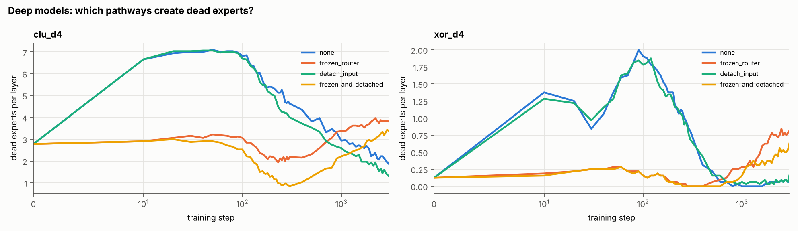

- **Freezing the router does not stop collapse in deep models.** It adds 1.0–1.3 dead experts per layer beyond
  step 0, slowly, after ~step 300 (D1 pass, depths 2 and 4).
- **Detaching the router input reduces dead experts:** −0.9 per layer at depth 2, −0.6 at depth 4 (D2 pass).
  Freezing *and* detaching still lets dead experts creep up late at depth 4, so incidental drift contributes too.
- **When the router learns, its weights dominate.** The logit decomposition attributes ~99% of the
  routing-relevant change to the router weights. The representation pathway is slow, and it matters most when the
  router is fixed or held back.
- **Tasks the router can't see stay unrouted.** Without a dense pre-block, XOR routing recovers 14% of the task
  information (D3 pass). With one, about 55%.
- **The cosine router does not help in deep stacks.** It shifts more of the change to the representations and adds
  dead experts at depth 4.

### E3 v2 – a larger LM, with release and pathway probes

**Setup.**
- 4 layers, d_model 128, 16 experts × 64 (top-2); 3000 steps.
- 3 seeds (2 for the α=0.003 and α=0.03 runs).
- Scaled down from the planned 4000 steps × 4 seeds after measuring ~0.33 s/step on one CPU thread.

Full table: [`results/summary_e3v2_cpu.md`](results/summary_e3v2_cpu.md).

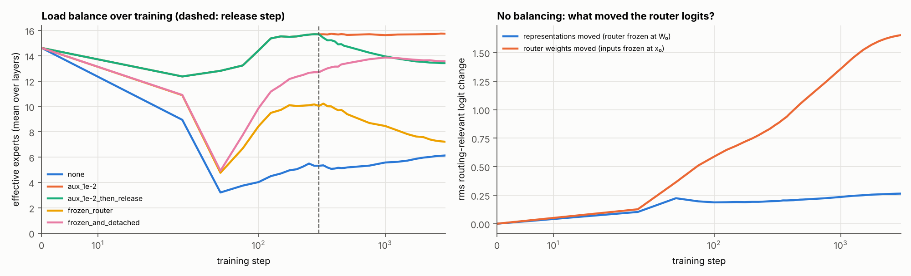

| method | val loss (nats/byte) | gap closed (dense-active → dense-total) | dead / layer | late deaths / run |
|---|---|---|---|---|
| dense, active params | 1.558 | 0 | – | – |
| dense, total params | 1.414 | 1 | – | – |
| no balancing | 1.526 | 0.22 | 6.8 | 3.7 |
| aux 0.003 / 0.01 / 0.03 | 1.498 / 1.492 / 1.488 | 0.42–0.49 | 0 | 0 |
| aux-free bias | 1.489 | 0.48 | 0 | 0 |
| aux 0.01 for 300 steps, then off | 1.497 | 0.42 | 0.7 | 2.7 |
| bias for 300 steps, then frozen | 1.502 | 0.39 | 1.9 | 7.0 |
| fixed byte hash | 1.487 | 0.49 | 0 | 0 |
| router frozen | 1.590 | −0.22 | 4.9 | 15.3 |
| router input detached | 1.536 | 0.15 | 5.8 | 5.7 |
| frozen + detached | 1.622 | −0.44 | 0.1 | 0.3 |

- **Timing.** Without balancing, dead experts per layer peak at 10.4 around step 100. 78% of eventually-dead
  experts are dead by step 100, and only 1% die after step 1000. Unlike the synthetic tasks, the LM recovers
  partly (6.8 dead per layer at the end, 20 revivals per run): the representations keep moving, so starved experts
  occasionally get picked up again.
- **Pathways.**
  - The router's weights carry 97% of the routing-relevant logit change (rms 1.65 vs 0.26).
  - Neither pathway alone reproduces the dead experts (1.9 and 0.5 vs 7.3 actual on the probe), so collapse comes
    from the two moving *together*.
  - With the router frozen, the representations alone collapse it slowly: 4.9 dead per layer, median death
    step 750.
  - With the input also detached, it doesn't collapse at all (0.1). In this LM it is specifically the routing
    gradient pulling representations that does the damage.
- **Release does not help here.**
  - Every balancing method lands within noise of the others (s.e. up to 0.025).
  - Releasing lets a few experts die late (0.7 per layer); freezing the bias, more (1.9).
  - In this LM a fixed byte hash is as good as balanced learned routing. Learned routing's advantage over hashing
    from round 1 does not appear at this scale.

#### GPU preset (Kaggle T4, 19 of 21 runs)

**Setup.**
- 6 layers, d_model 256, 32 experts × 128 (top-2), context 256, 10k steps, lr 1e-3, 3 seeds.
- Run on one Kaggle T4. Per run that took about 13.5 min for `dense_active`, 36–42 min for an MoE and 47 min for
  `dense_total`.
- Kaggle's 12 h limit stopped the run before `detach_input` seeds 1–2, so that method has n = 1.

Full tables: [`results/summary_e3v2_gpu.md`](results/summary_e3v2_gpu.md).

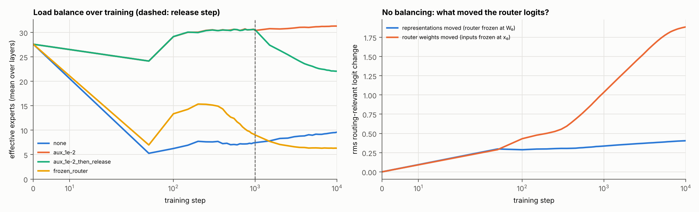

**The preset overfits, so its final losses can't be compared.** The training text is ~1.5 MB (550 KB per domain
minus 10% validation), and 10k × 32 × 256 bytes is ~55 passes over it.
- Every run's val loss bottoms out between steps 1500 and 4500, then rises until the end.
- Final val loss ranges from 1.56 (`frozen_router`) to 3.43 (`dense_total`). That ordering tracks how fast each
  model memorises, not how well it models text.

| method | best val (nats/byte) | step of best | final val | dead / layer at end | n |
|---|---|---|---|---|---|
| dense, active params | 1.341 ± 0.008 | 3500–4000 | 1.603 | – | 3 |
| dense, total params | 1.347 ± 0.004 | 1500–2000 | 3.433 | – | 3 |
| no balancing | 1.354 ± 0.009 | 3000–3500 | 1.768 | 15.5 | 3 |
| aux 0.01 | 1.340 ± 0.006 | 2000–2500 | 2.459 | 0 | 3 |
| aux 0.01 for 1000 steps, then off | 1.342 ± 0.004 | 2000–2500 | 2.451 | 5.2 | 3 |
| router frozen | 1.350 ± 0.014 | 3500–4500 | 1.556 | 22.4 | 3 |
| router input detached | 1.348 | 3000 | 1.771 | 16.2 | 1 |

*Best val* is selected on the same val split it's reported on, so it is slightly optimistic, equally for every
method.

- **No method is distinguishable at its best checkpoint.** Paired by seed against no balancing, aux 0.01 is −0.013
  [−0.035, +0.015] and release −0.011 [−0.029, +0.012]. Even `dense_total`, with 5.6× the parameters of
  `dense_active`, is no better. The corpus is too small to reward capacity, so it can't reward balancing either.
- **Collapse replicates, early.** Without balancing:
  - seed 0 already has 24.8 of 32 experts dead per layer at step 50;
  - the median death step is 50, and 66% of deaths happen by step 100;
  - experts partly revive later (15.7 dead per layer at the end, ~60 revivals per run). That is the same "early race,
    partial recovery" as the CPU preset, at a larger scale.
- **Pathways replicate.**
  - The router's weights carry ~94% of the routing-relevant logit change (CPU: 97%).
  - Neither pathway alone reproduces the dead experts (3.7 and 3.9 vs 15.8 on the probe).
  - With the router frozen, the representations still collapse it, more slowly (median death step 650; CPU: 750)
    but further (22.4 dead per layer at the end).
  - The frozen + detached control that stopped collapse in the CPU preset was not run here.
- **Release:** all experts that die under release do so after the release step (5.2 dead per layer at the end), as in
  the CPU preset.

### E7 – real pretraining checkpoints (built, not run yet)

`experiments/e7_real_checkpoints.py` loads a public MoE's intermediate checkpoints (default: OLMoE-1B-7B) and
reports per-layer load, dead experts, and *router saturation* (overlap with the final checkpoint's top-k) across
training. Caveats:
- It was tested only on tiny randomly initialised OLMoE-architecture models, because Hugging Face is unreachable
  from the environment that produced these results.
- It needs a ≥ 24 GB GPU, or two 15 GB cards with `--device_map auto` (Kaggle T4 ×2; cell in the notebook). The
  first Kaggle attempt had no GPU attached; the second spent its 12 h on the E3 v2 GPU preset before reaching E7.
- OLMoE was trained *with* load balancing, so it can show when routing settles at scale, but not whether
  unbalanced collapse is late.

## 4. What I'd actually do

1. **Instrument from step 0, per layer.** Log these:
   - effective experts and dead experts;
   - router entropy;
   - an ablation- or substitution-based redundancy measure (not plain CKA).

   Most of the outcome is set in the first few percent of training. Compare against dense baselines at matched
   *active* and *total* parameters, and report "gap closed".
2. **Balance early and strongly enough, then relax rather than hold strict balance forever.**
   - Release variants were the most robust family across 11 regimes.
   - In the LM, keeping a modest aux loss on was just as good, and releasing let a few experts die late.
   - A reasonable default: keep a *weak* balance term for the whole run, with a stronger one early (α≈0.03–0.3 in
     the synthetic tasks; α≈0.01 was enough in the LM).
   - Check effective experts at step ~100 instead of trusting any default α.
3. **Use Adam-style optimizers for routers.** If you must use SGD, normalise per-expert router-row gradients.
4. **In deep models, the representations are part of the router.** Freezing or fixing router weights does not
   prevent collapse. Blocking the routing gradient into the representations (detach) reduces it at some cost. Keep
   the balance pressure in the objective or the selection rule.
5. **Avoid known traps:**
   - renormalised top-1 gates (zero router gradient);
   - z-loss as a balancer;
   - strong permanent bias balancing on skewed data;
   - expert-choice routing (non-causal, and fragile when skills are skewed);
   - treating Sinkhorn's balanced selection as evidence the router itself is balanced. Release it and it can
     collapse back.
6. **If the router can't see the structure, balance won't create specialisation.** Check whether routing carries
   information about anything meaningful: token identity, domain, or a ground-truth label. If it doesn't, an MoE
   can be no better than a dense model with the same total parameters.

## 5. Limits of this evidence (after round 2)

- **Scale.** Everything except the GPU LM preset ran on 4 CPU cores. The largest CPU LM has 4 layers, 16 experts,
  3000 steps and 3 seeds; differences among balancing methods there are within noise.
- **The GPU LM preset is data-limited.** 6 layers, 32 experts, 10k steps on one Kaggle T4, 19 of 21 runs, 3 seeds
  (1 for `detach_input`). It makes ~55 passes over ~1.5 MB of training text, so val loss rises after step ~3000 in
  every run. Method comparisons need more data or fewer steps.
- **The CPU LM preset may be near the same turn.** It processes ~12M bytes (~8 passes). In the GPU preset that is
  roughly where `dense_total` was already at its best and turning up. The CPU run's raw per-step histories aren't in
  the repo, so I can't check whether its final-checkpoint ranking (dense-total best) is affected.
- **Late collapse at real scale is still untested.** E7 is built but has not been run on real checkpoints; it also
  only covers a model trained with balancing.
- **The synthetic tasks are stylised.** Clusters or XOR bits with random teachers stand in for "skills"; real data
  has graded, overlapping structure.
- **Tuning used one grid per method on four regimes.** The held-out test used a single global config per method,
  which is the fair comparison, but a method could do better tuned per setting.
- **Round-2 design was also done after seeing data.** The held-out regimes and predictions were chosen after round
  1, so pre-registration protects E5/E6 from tuning-to-results, not from my choice of what to test.
- **The LM pathway result (frozen + detached ⇒ no collapse) rests on 3 seeds** of one architecture.

## 6. What's in the repo

```
moe_lab/
  moe.py              MoE layer. Every router reduces to a dispatch mask M[N,E] + combine weights G[N,E]:
                      softmax_topk (Switch), topk_renorm (Mixtral), sigmoid_topk (DeepSeek-V3), sinkhorn
                      (S-BASE), expert_choice, hash, oracle; linear or cosine (X-MoE) router; capacity factor;
                      exploration noise; Switch aux loss (batch- or sequence-level); z-loss; aux-loss-free bias;
                      router_detach_input
  data.py             synthetic mixture-of-tasks (clusters or XOR task ids; MSE or cross-entropy; train/val/test),
                      and 3-domain byte-level text (Shakespeare / Python stdlib source / CPython reference docs)
  models.py           single MoE layer, deep residual MoE stack (optional dense pre-block), MoE transformer
  metrics.py          load, router entropy, MI specialisation, CKA / routed CKA, substitution gap, logit decomposition
  stats.py            paired bootstrap CIs, sign-flip permutation tests, Holm correction
  train_synthetic.py  trainer + interventions (frozen router/experts, router LR and warm-up, split router/expert
                      optimizers, router row-norm, load-normalised grads, head start, zero-init, balance-then-release,
                      dead-expert revival) + counterfactual diagnostics
  train_lm.py         MoE transformer trainer + per-layer / per-domain routing diagnostics, dense early logging,
                      logit decomposition, balance-then-release
experiments/
  e1_mechanisms.py    WHY: interventions on each link of the feedback loop (round 2: 20 seeds + SGD factorial)
  e2_fixes.py         FIXES (round 1): 18 methods × 4 regimes
  e3_lm.py            LM presets: round1 / cpu / gpu
  e4_tuning.py        per-method tuning (tune → select → eval)
  PREREGISTRATION.md  predictions for E5/E6, committed before they ran
  e5_heldout.py       pre-registered held-out test (7 new regimes)
  e6_deep.py          depth and the representation pathway
  e7_real_checkpoints.py  routing across a real MoE's pretraining checkpoints (GPU + Hugging Face)
  analyze.py, analyze2.py  figures, summary tables, per-run CSVs (round 1, round 2)
notebooks/moe_load_balancing_lab.ipynb   Kaggle/Colab driver for the GPU LM preset and E7
tests/test_moe.py     22 checks of the routing math, diagnostics, statistics and GPU assignment
results/              summary_*.md, figures/, runs_*.csv, tuned_configs.json (raw JSON is git-ignored)
```

**Why synthetic tasks with ground truth.** In real models you can't tell whether an expert is "specialised",
because you don't know what the right specialisation is. Here each latent task has its own random teacher network.
That makes three reference points possible:
- **oracle routing** (route by the true task);
- **dense baselines** at matched active and total parameters;
- **counterfactual losses** (every expert on every task).

**Running it** (CPU wall-clock on 4 cores):

```bash
pip install -r requirements.txt && python -m pytest -q tests
cd experiments
python e1_mechanisms.py                       # ~1.5 h (20 seeds)
python e2_fixes.py --seeds 8                  # ~50 min (round 1)
python e4_tuning.py tune && python e4_tuning.py select && python e4_tuning.py eval   # ~3 h
python e5_heldout.py && python e6_deep.py     # ~3 h
python e3_lm.py --preset cpu                  # ~4 h; GPU: --preset gpu --device cuda --workers <n GPUs>
python analyze.py && python analyze2.py
```

Results are cached per run, so every script resumes.
- Raw per-run JSON goes to `results/<exp>/` and is git-ignored, except the GPU LM runs (`results/e3v2_lm_gpu/`),
  which cost 12 GPU-hours to produce.
- `results/runs_*.csv` holds every run's final metrics.

To try a new idea, add an option to `MoEConfig` / `_route` (or a trainer flag) and a grid entry in
`e4_tuning.py`. Freeze it with `select` before testing it on held-out regimes.

## References

- Shazeer et al., 2017. *Outrageously Large Neural Networks: The Sparsely-Gated Mixture-of-Experts Layer* (noisy top-k, importance loss).
- Lepikhin et al., 2020. *GShard*.
- Fedus, Zoph & Shazeer, 2021. *Switch Transformers* (the `E·Σ f·P` aux loss, capacity factor).
- Lewis et al., 2021. *BASE Layers* (balanced assignment). Roller et al., 2021. *Hash Layers for Large Sparse Models*.
- Clark et al., 2022. *Unified Scaling Laws for Routed Language Models* (Sinkhorn-based S-BASE).
- Zhou et al., 2022. *Mixture-of-Experts with Expert Choice Routing*.
- Zoph et al., 2022. *ST-MoE: Designing Stable and Transferable Sparse Expert Models* (router z-loss).
- Chi et al., 2022. *On the Representation Collapse of Sparse Mixture of Experts* (X-MoE cosine router).
- Dai et al., 2024. *DeepSeekMoE* (fine-grained and shared experts). Jiang et al., 2024. *Mixtral of Experts* (routing analysis).
- Wang et al., 2024. *Auxiliary-Loss-Free Load Balancing Strategy for Mixture-of-Experts*; DeepSeek-AI, 2024. *DeepSeek-V3 Technical Report*.
- Muennighoff et al., 2024. *OLMoE*.
- Qiu et al., 2025. *Demons in the Detail: On Implementing Load Balancing Loss for Training Specialized Mixture-of-Expert Models* (global- vs micro-batch balancing).
